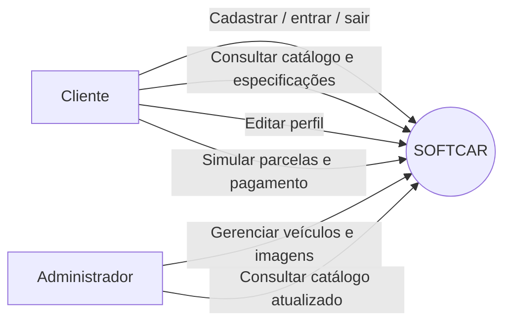
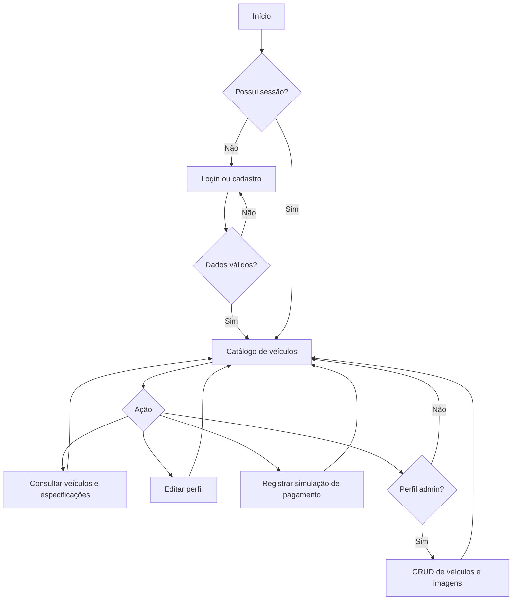

# DOCUMENTAÇÃO DO SISTEMA — SOFTCAR

**Versão:** 1.0  
**Data:** 24/11/2026  
**Autores:** Gabriel Henrique, Lucas Werneck, Victor Barcelos e Victor Silva  
**Instituição:** UniCEUB — Ciência da Computação — Desenvolvimento Web, Turma B  
**Status:** rascunho para revisão e formatação final conforme ABNT.

## 1. Introdução

A SOFTCAR é uma concessionária fictícia voltada à apresentação e comercialização de veículos novos e seminovos. Conforme o briefing da empresa, o público inclui pessoas interessadas em comprar veículos e clientes que buscam informações sobre produtos e serviços automotivos. O sistema apresenta catálogo, galeria, especificações e conteúdo institucional; permite cadastrar usuários, manter perfil, administrar veículos e registrar simulações demonstrativas de pagamento.

O projeto foi desenvolvido para atender à atividade prática de Desenvolvimento Web do UniCEUB. O briefing e o modelo de documentação fornecidos pela disciplina orientam esta descrição. As telas e materiais de planejamento existentes estão em `frontend/documentos.html` e em `frontend/imagens/figma_wireframe/`.

### 1.1 Tecnologias

- PHP e PDO para a API JSON e acesso ao banco.
- MySQL/MariaDB para persistência e relacionamento dos dados.
- HTML5, CSS3 e JavaScript para páginas estáticas, apresentação e chamadas à API.
- XAMPP como ambiente local de execução.

### 1.2 Arquitetura e responsabilidades

- **Front-end (`frontend/`)**: páginas HTML, estilos, interações JavaScript e imagens. Não contém PHP nem regras de acesso ao banco.
- **Back-end (`backend/`)**: endpoints PHP que recebem/retornam JSON, validam sessão/permissões, aplicam regras de negócio e acessam o banco via PDO.
- **Comunicação**: a API `backend/api/` retorna JSON, usa sessão segura e token CSRF nas operações de escrita. Para o futuro front-end React/Vite, o proxy de desenvolvimento encaminha `/backend` ao Apache.

### 1.3 Modelo de dados

- **usuarios**: contas e perfil de autorização (`cliente` ou `admin`).
- **marcas** e **categorias**: tabelas de referência dos veículos.
- **veiculos**: dados, preço, disponibilidade e caminho da imagem; cada veículo referencia uma marca e uma categoria.
- **pagamentos**: simulação ligada a um usuário e a um veículo, com valor, forma e status demonstrativo.

As relações são implementadas por chaves estrangeiras InnoDB em `backend/config/database.sql`.

## 2. Requisitos funcionais

| Código | Nome | Descrição |
|---|---|---|
| RF01 | Cadastro de usuários | Permitir que novos usuários criem uma conta de cliente/comprador; apenas administradores podem criar contas administrativas. |
| RF02 | Login de usuários | Permitir que usuários cadastrados façam login. |
| RF03 | Logout de usuários | Encerrar a sessão e retornar à tela de login/cadastro. |
| RF04 | Perfil | Permitir que o usuário autenticado consulte seu perfil. |
| RF05 | Editar perfil | Permitir atualizar nome, e-mail e senha do próprio usuário. |
| RF18 | Painel administrativo | Permitir que somente administradores acessem o painel. |
| RF19 | Adicionar ao catálogo | Permitir que administradores cadastrem veículos. |
| RF20 | Remover do catálogo | Permitir que administradores removam veículos sem pagamentos vinculados. |
| RF21 | Editar veículos | Permitir que administradores atualizem os dados do veículo. |
| RF22 | Editar especificações | Usar os dados atualizados do veículo na tabela técnica. |
| RF23 | Atualizar imagens | Permitir adicionar, substituir ou remover a imagem associada ao veículo. |
| RF06–RF17 | Outros requisitos | Códigos não detalhados no escopo desta revisão; preencher conforme a lista oficial do projeto. |

## 3. Requisitos não funcionais

| Código | Nome | Descrição |
|---|---|---|
| RNF01 | Ambiente | Executar localmente no Apache e MySQL/MariaDB disponibilizados pelo XAMPP. |
| RNF02 | Separação | Manter HTML/CSS/JavaScript em `frontend/` e processamento PHP/API em `backend/`. |
| RNF03 | Persistência | Usar PDO, consultas preparadas, InnoDB e chaves estrangeiras. |
| RNF04 | Proteção de credenciais | Armazenar senhas com hash, não em texto simples. |
| RNF05 | Autorização | Restringir as operações administrativas ao perfil `admin`, com validação no backend. |
| RNF06 | Integridade | Validar dados recebidos e manter os vínculos entre usuários, veículos e simulações. |
| RNF07 | Compatibilidade | Apresentar navegação adaptável a telas menores e usar HTML/CSS/JavaScript compatíveis com navegadores modernos. |

## 4. Regras de negócio

| Código | Nome | Descrição |
|---|---|---|
| RN01 | Conta necessária | Para acessar o catálogo, o perfil e as simulações, a pessoa deve estar cadastrada e autenticada. |
| RN02 | Privilégio administrativo | Somente uma conta marcada como `admin` pode acessar o painel. Cadastros públicos são sempre `cliente`; apenas um administrador autenticado pode criar contas de administrador pelo painel. |
| RN03 | E-mail único | Cada conta deve possuir um e-mail exclusivo. |
| RN04 | Veículo disponível | O sistema só permite registrar uma simulação de pagamento para veículos disponíveis. |
| RN05 | Pagamento acadêmico | A opção de pagamento apenas registra uma simulação; não realiza cobrança nem solicita dados financeiros. |
| RN06 | Integridade referencial | Veículos vinculados a simulações não podem ser excluídos; marcas e categorias referenciadas não podem ser removidas. |
| RN07 | Imagens | Upload aceita apenas arquivos JPG, PNG ou WEBP válidos, com tamanho máximo de 5 MB. |

## 5. Diagrama de caso de uso

## 6. Diagrama de fluxo do sistema

## 7. Wireframe e protótipo

Os wireframes disponíveis estão apresentados em `frontend/documentos.html` e armazenados em `frontend/imagens/figma_wireframe/`. Incluem as áreas de início, galeria, artigos, tabelas e componentes adicionais. Revisar se os wireframes representam também login/cadastro, perfil, painel administrativo e pagamento antes da apresentação. O protótipo navegável deve ser anexado ou receber seu link nesta seção quando disponibilizado pelo grupo.

## 8. Páginas implementadas

- Login e cadastro: `frontend/login.html` e `frontend/cadastro.html`.
- Catálogo: `frontend/index.html`.
- Perfil e histórico: `frontend/perfil.html`.
- Administração: `frontend/admin.html`.
- Pagamento demonstrativo: `frontend/pagamento.html`.
- Conteúdo institucional: `frontend/empresa.html`, `frontend/galeria.html`, `frontend/textos.html` e `frontend/documentos.html`.
- Especificações: `frontend/tabela.html`.

## 9. Aplicação de JavaScript

O arquivo `frontend/app.js` contém funções, condicionais, eventos e interações com o usuário. O simulador apresenta campos para veículo, entrada e prazo; calcula saldo e parcelas no navegador. O resultado é uma estimativa sem juros e não constitui oferta de financiamento. A migração para React/Vite ainda não está no workspace; o proxy recomendado está descrito no README.

## 10. PHP e banco de dados

O cadastro público cria clientes. A API `backend/api/admin/users.php` permite que somente um administrador autenticado crie clientes ou outros administradores. Login, logout, perfil, autorização, CRUD de veículos/imagens e simulações também são processados pela API PHP em `backend/api/`. Imagens enviadas pelo painel ficam em `frontend/imagens/uploads/`; a pasta `frontend/imagens/` não deve ser apagada. Uma imagem substituta do catálogo está em `frontend/imagens/sem-imagem.svg`. Os arquivos estáticos originais de logo, patrocinadores e wireframes não estão presentes neste estado do projeto e precisam ser adicionados pelo grupo. A conexão PDO e os cabeçalhos CORS estão centralizados em `backend/config/db.php`; os dados locais ficam em `backend/config/database.config.php`, com possibilidade de sobrescrita por variáveis `SOFTCAR_DB_*`. O padrão é `127.0.0.1:3306`, banco `softcar`, usuário `root` e senha vazia para XAMPP. O script `backend/config/database.sql` cria o banco, as tabelas e registros iniciais. A autenticação usa `password_hash`/`password_verify`, consultas preparadas, sessão PHP e CSRF.

## 11. Verificação de aderência ao briefing da disciplina

| Item do briefing | Situação |
|---|---|
| Descrição do projeto baseada no briefing | Atendido neste documento; revisar com o briefing final do grupo. |
| Requisitos funcionais e não funcionais | Atendido nas seções 2 e 3. |
| Regras de negócio | Atendido na seção 4. |
| Diagrama de caso de uso | Esboçado em Mermaid; exportar como imagem no documento final. |
| Diagrama de fluxo | Esboçado em Mermaid; exportar como imagem no documento final. |
| Wireframe e protótipo | Wireframes presentes; anexar link/arquivo de protótipo e atualizar as telas conforme as novas funções. |
| HTML, CSS, JavaScript, PHP e banco de dados | Implementados em camadas separadas; testar a demonstração com XAMPP. |
| Formulário e cálculos em JavaScript | Simulador de parcelas com campos e cálculo no navegador. |
| Apresentação prática | Preparar demonstração de cadastro, perfil, autorização admin, CRUD e simulação. |
| Padrão ABNT e identificação dos integrantes | Identificação incluída; aplicar no editor os elementos de formatação ABNT e revisar as referências antes da entrega. |

## 12. Pontos pendentes antes da entrega

1. Atualizar briefing e documentação com as decisões finais do grupo e com o link do protótipo.
2. Atualizar/criar wireframes das novas telas de autenticação, perfil, administração e simulação.
3. Exportar os diagramas Mermaid para imagens e inserir no documento final.
4. Revisar dados comerciais, preços, descrições e imagens de demonstração dos veículos.
5. O briefing institucional menciona peças, acessórios, manutenção e revisão; esses módulos ainda não fazem parte do catálogo funcional atual.
6. O fluxo de pagamento é intencionalmente apenas demonstrativo; uma cobrança real exigiria escolher e configurar um provedor externo.
7. Confirmar o prazo oficial de entrega: o PDF do projeto menciona 03/12/2025, embora o cronograma nele esteja marcado para dezembro de 2026; o briefing institucional do site cita 17/09/2026.
8. Aplicar a formatação ABNT solicitada pela disciplina no arquivo final.

## Referência

CENTRO UNIVERSITÁRIO DE BRASÍLIA (CEUB). **Projeto Final: Desenvolvimento Web — Turma B**. Material da disciplina fornecido em PDF. [S. l.]: CEUB, [s. d.].
